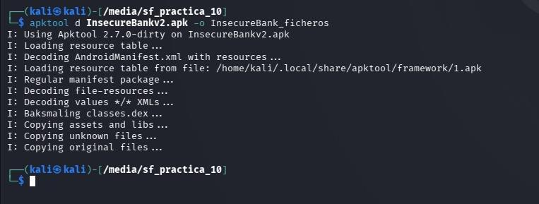
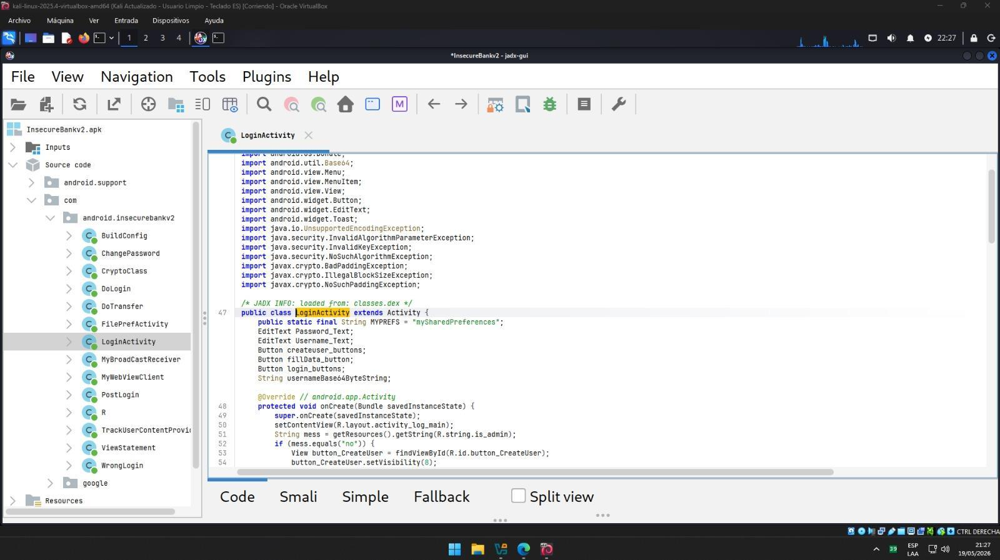

# 10 · Android: análisis estático de InsecureBankv2

**Estado:** análisis documentado. Validación dinámica y retest de mitigaciones pendientes.

## Objetivo y entorno

Inspeccionar una APK deliberadamente vulnerable mediante APKTool y JADX-GUI, desde Kali Linux, y separar observaciones de código de impactos demostrados.

## Procedimiento documentado

1. Desensamblar la APK: `apktool d InsecureBankv2.apk -o InsecureBank_ficheros`.
2. Abrir la APK con JADX-GUI e inspeccionar `com.android.insecurebankv2`, especialmente `LoginActivity`.
3. Localizar referencias a preferencias, campos de usuario y decisiones de privilegios.

## Qué permite concluir la evidencia

| Observación | Interpretación y siguiente comprobación |
|---|---|
| `MYPREFS = "mySharedPreferences"` en `LoginActivity` | Identifica un almacén; no demuestra por sí solo qué credenciales contiene ni su protección. Rastrear escritura/lectura y revisar el archivo en el emulador. |
| Clases y métodos legibles | Facilita el análisis. La ausencia de ofuscación no demuestra acceso no autorizado. |
| Imports `javax.crypto` y `Base64` | Indican código que revisar; no prueban una implementación criptográfica vulnerable. |
| Referencia a `is_admin` descrita en el informe | Hipótesis para verificar: comprobar si el servidor rechaza operaciones de un usuario sin privilegios, incluso si se altera el cliente. |

## Mitigaciones propuestas

Validar autorización en el servidor; minimizar datos sensibles persistidos y evitar almacenar contraseñas. Si se necesita cifrado local, diseñar la gestión de claves con Android Keystore y un modo autenticado apropiado. Ofuscación e integridad son capas adicionales, no sustitutos de autorización.

La recomendación histórica de `EncryptedSharedPreferences` requiere actualización: la API está [deprecada](https://developer.android.com/reference/androidx/security/crypto/EncryptedSharedPreferences). Esto no significa que guardar secretos sin protección en preferencias sea una alternativa válida. Pinning/RASP requieren evaluar compatibilidad, mantenimiento y modelo de amenazas; no se han implementado en esta práctica.

## Siguiente evidencia por completar

- Registrar versión y SHA-256 de la APK.
- Añadir ubicación exacta del método de escritura y lectura de datos sensibles.
- Ejecutar una prueba controlada de autorización y documentar resultado esperado/observado.
- Repetir la prueba después de una corrección en un entorno modificable.

## Evidencia del informe original

Página 3: APKTool completa la extracción de recursos y bytecode.

Página 5: LoginActivity visible en JADX; punto de partida para rastrear el uso de preferencias.

## Informe y trazabilidad

[Leer informe original](informe-practica10.pdf) · [Notas de revisión técnica](../docs/REVISION-TECNICA.md) · [Portafolio](../README.md)

Las imágenes son extracciones de las páginas indicadas en su nombre, sin recrear resultados. El PDF histórico conserva su redacción original; las precisiones de este README deben leerse junto a él.
