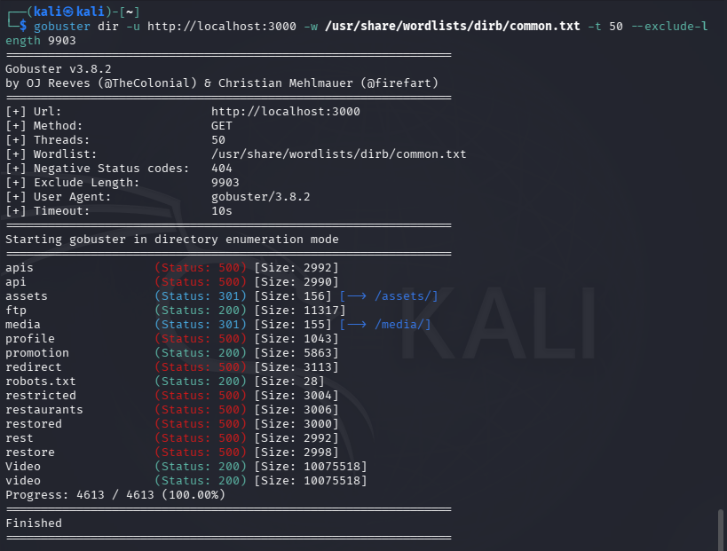
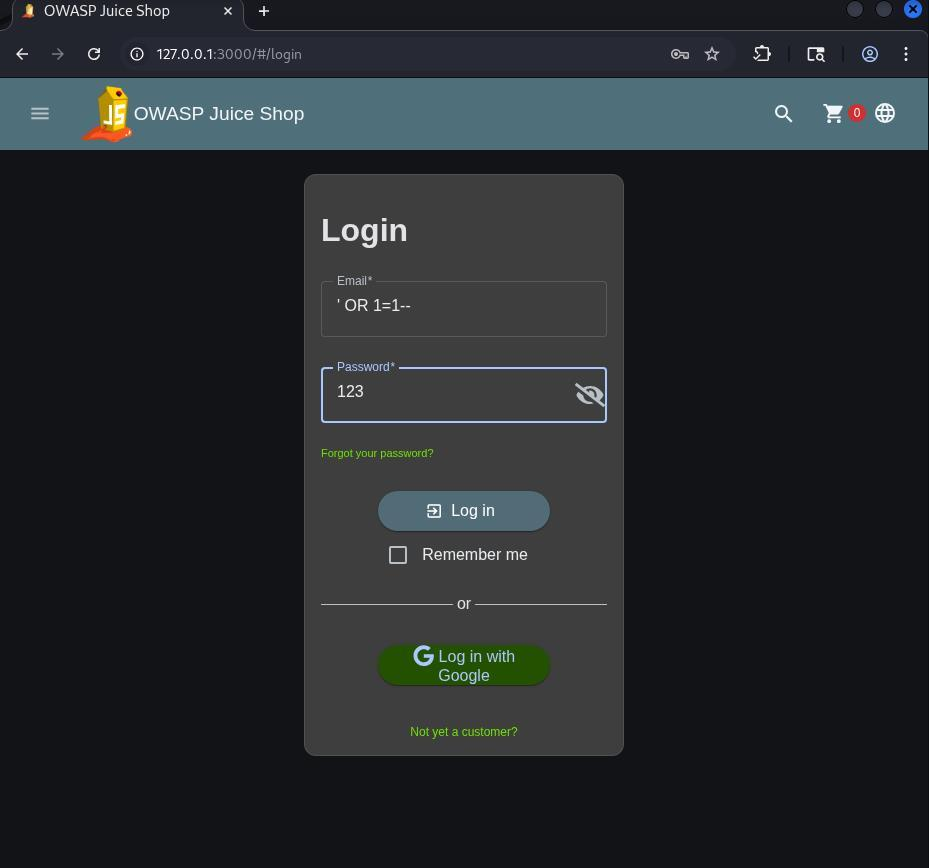
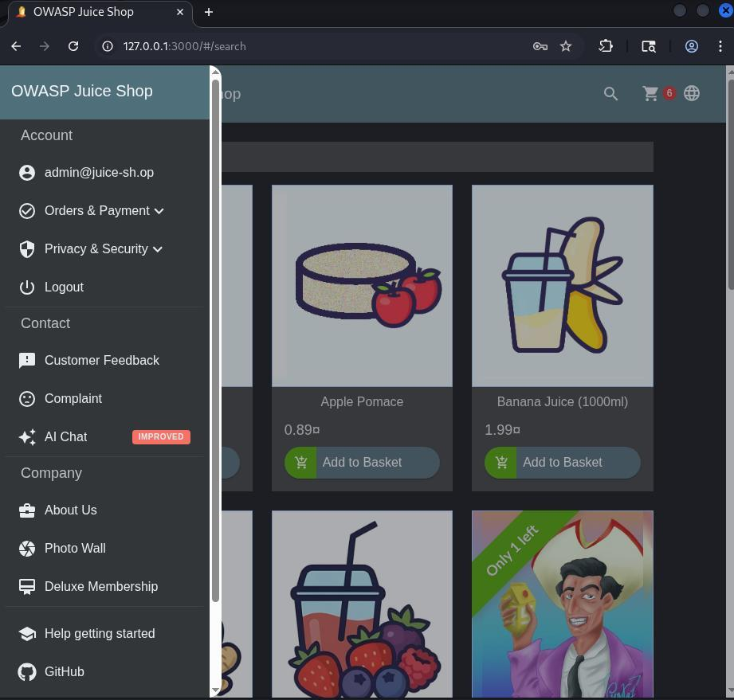

# 11 · Seguridad web: OWASP Juice Shop

**Estado:** evaluación de alcance limitado documentada. Correcciones y retest pendientes.

## Alcance

Instancia local de OWASP Juice Shop en Docker, accesible en `localhost:3000`, con Kali Linux, Nmap, Gobuster, Nikto, curl y Burp Suite Community. Se revisaron superficie HTTP, rutas, cabeceras y autenticación. No se afirma cobertura completa de OWASP WSTG o PTES.

## Resultados y límites

| Resultado | Evidencia / interpretación |
|---|---|
| Bypass de autenticación por SQL injection | Petición, respuesta y sesión administrativa en páginas 17–19. [Caso de estudio](CASO-SQLI.md). |
| Acceso con credenciales débiles del laboratorio | Documentado en páginas 15–16; no demuestra compromiso de sistemas externos. |
| Servicio HTTP sin TLS | Configuración observada del laboratorio; el impacto depende de la exposición y de los datos transportados. |
| `/ftp` accesible | Evaluar contenido y autorización prevista antes de asignar severidad. Una ruta accesible no implica por sí misma una fuga sensible. |
| CORS con comodín y cabeceras ausentes | Observaciones para revisión contextual; no se asigna severidad automática. |
| Respuestas 500 en varias rutas | Errores que requieren inspección; no prueban bypass de autorización ni redirección abierta. |

## Decisiones metodológicas

- Gobuster necesitó excluir una longitud de respuesta del fallback SPA. Ese valor depende de la versión; volver a medirlo al reproducir.
- Un resultado de entropía de Sequencer no valida la seguridad de un JWT, tampoco analizando solamente su firma. Revisar validación criptográfica, algoritmos permitidos y claims como expiración, emisor y audiencia cuando correspondan. [RFC 8725](https://www.rfc-editor.org/rfc/rfc8725.html).
- CORS `*` puede ser correcto para recursos públicos. Documentar un acceso a datos sensibles antes de reportarlo como vulnerabilidad. [OWASP CORS](https://cheatsheetseries.owasp.org/cheatsheets/CORS_Security_Cheat_Sheet.html).
- No se han medido puntuaciones CVSS ni demostrado cadenas de ataque entre cabeceras ausentes y otros hallazgos.

## Enfoque defensivo

Correlacionar autenticaciones con logs de aplicación, cambios de identidad y solicitudes anómalas. Un access log habitual no registra el cuerpo POST del login: la ausencia del payload en ese log no descarta SQL injection. Evitar registrar contraseñas o tokens para añadir visibilidad.

## Evidencia del informe original

Página 5: enumeración de rutas, con exclusión del fallback SPA.

Página 17: entrada de prueba en el formulario del laboratorio.

Página 19: sesión administrativa documentada después del bypass.

## Informe y trazabilidad

[Leer informe original](informe-practica11.pdf) · [Notas de revisión técnica](../docs/REVISION-TECNICA.md) · [Portafolio](../README.md)

Las imágenes son extracciones de las páginas indicadas en su nombre, sin recrear resultados. El PDF histórico conserva su redacción original; las precisiones de este README deben leerse junto a él.

## Alcance e inventario

La [guía de reconocimiento con Nmap](../04-nmap-reconocimiento/README.md) queda como material de apoyo. Usar el inventario documentado en el informe para explicar qué servicio entró en el alcance y qué se pudo comprobar en la aplicación de laboratorio.
