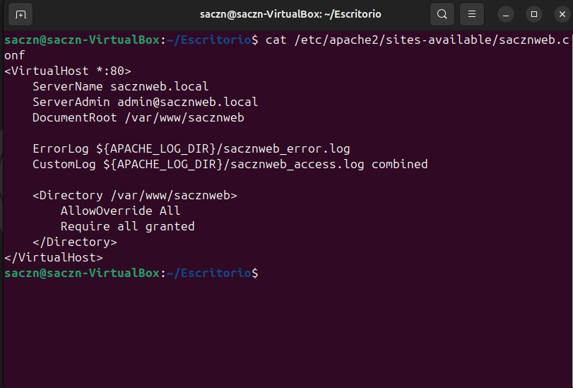
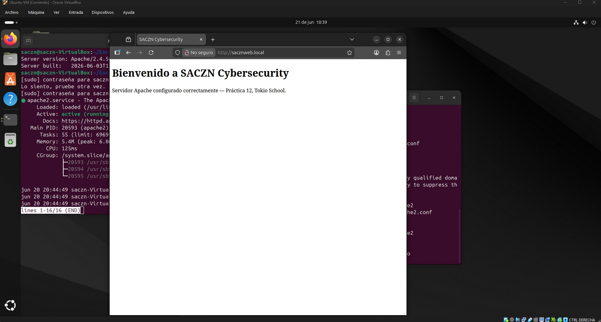

# 12 · Apache: Virtual Hosts y recuperación

**Estado:** despliegue documentado; backup automatizado y restauración en VM pendientes de validación.

## Resultado documentado

Apache 2.4.58 en Ubuntu virtualizado sirve el sitio `sacznweb.local` desde `/var/www/sacznweb`. Se activó un VirtualHost propio, se desactivó el sitio por defecto y se corrigió el aviso AH00558 mediante `ServerName localhost` global.

## Archivos y procedimiento

- [VirtualHost original transcrito](config/sacznweb.conf), basado en la captura de la página 6. Conserva `AllowOverride All` para reflejar el estado original.
- [Plan de hardening y recuperación](VALIDACION.md), con cambios propuestos y criterios de aceptación.
- [Script de backup](../tools/apache-backup/README.md), nueva herramienta para generar un archivo e inventario; no es evidencia de ejecución histórica.

En una VM propia con Apache instalado, crear el DocumentRoot y el sitio, revisar la configuración, copiar el VirtualHost a `sites-available`, habilitarlo y ejecutar `apache2ctl configtest` antes de recargar. Resolver `sacznweb.local` hacia la IP de esa VM; `127.0.0.1` solo corresponde cuando el cliente está en la misma máquina.

## Qué falta demostrar

La sección de backup del PDF es una propuesta: no prueba cron, cumplimiento de la regla 3-2-1 ni una restauración. Para completar la ampliación, guardar una copia fuera del servidor y restaurar en una VM desechable, midiendo tiempo y verificando contenido y servicio.

## Evidencia del informe original

Página 6: VirtualHost original con DocumentRoot y logs separados.

Página 9: sitio propio cargando en el dominio local.

## Informe y trazabilidad

[Leer informe original](informe-practica12.pdf) · [Notas de revisión técnica](../docs/REVISION-TECNICA.md) · [Portafolio](../README.md)

Las imágenes son extracciones de las páginas indicadas en su nombre, sin recrear resultados. El PDF histórico conserva su redacción original; las precisiones de este README deben leerse junto a él.
