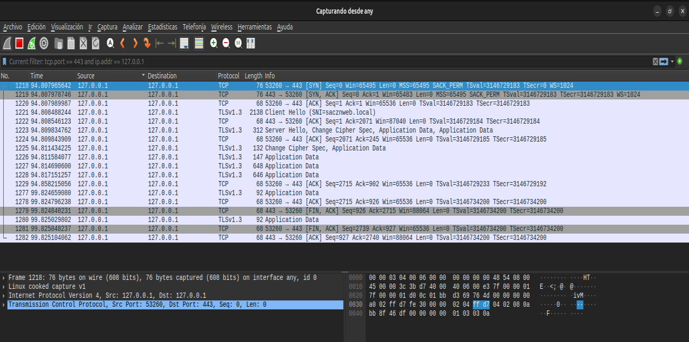
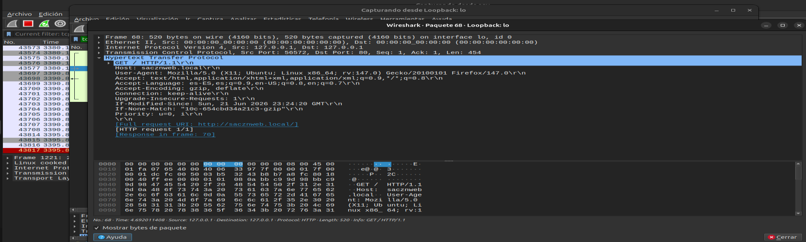

# 13 · Apache: TLS y análisis de tráfico

**Estado:** HTTPS y comparación de tráfico documentados. Configuración de endurecimiento propuesta pendiente de validar.

## Entorno y resultado

Ubuntu 24, Apache, OpenSSL y Wireshark 4.2.2. El sitio `sacznweb.local` usa un certificado autofirmado de laboratorio. Las capturas se realizaron en loopback (`127.0.0.1`), no sobre tráfico de terceros.

## Interpretación de la evidencia

| Observación | Conclusión y límite |
|---|---|
| GET y cabeceras visibles por HTTP | El contenido HTTP es legible para quien puede capturar ese tráfico. Estar en la misma red no garantiza por sí solo esa capacidad. |
| Registros TLS y Application Data por HTTPS | El contenido está cifrado en la captura sin claves de sesión. |
| ClientHello y ServerHello visibles | No significa que todo el handshake sea legible: en TLS 1.3 parte está cifrada. |
| SNI visible en esta captura | Describe este caso; no generaliza a conexiones que utilicen ECH. |
| Certificado autofirmado y uso de `curl -k` | La prueba histórica omitió la validación de confianza; no demuestra autenticación fiable del servidor. |

La captura de la página 9 contiene registros identificados como TLS 1.3. Para confirmar la versión negociada en una nueva ejecución, registrar `ServerHello` y la salida completa de `curl -v`; no deducirla solamente del campo de versión legado del ClientHello.

## Reproducción y mejora

[Configuración TLS propuesta](config/sacznweb-ssl.conf) · [Guía de validación](VALIDACION.md)

Un certificado autofirmado puede autenticar al servidor si se establece su confianza por un canal fiable y se verifica el nombre. En esta ampliación se propone un certificado con SAN y `curl --cacert`, sin omitir la verificación. Para un sitio público se necesita una cadena de confianza adecuada para sus clientes; una PKI privada puede servir en entornos administrados.

Referencias: [TLS 1.3](https://www.rfc-editor.org/rfc/rfc8446.html) · [Apache mod_ssl](https://httpd.apache.org/docs/2.4/mod/mod_ssl.html).

## Evidencia del informe original

Página 9: intercambio TLS con datos de aplicación cifrados.

Página 11: petición HTTP y cabeceras legibles en la captura.

## Informe y trazabilidad

[Leer informe original](informe-practica13.pdf) · [Notas de revisión técnica](../docs/REVISION-TECNICA.md) · [Portafolio](../README.md)

Las imágenes son extracciones de las páginas indicadas en su nombre, sin recrear resultados. El PDF histórico conserva su redacción original; las precisiones de este README deben leerse junto a él.

## Fundamentos aplicados

La [guía de captura con Wireshark y tcpdump](../03-redes-wireshark-tcpdump/README.md) y la [guía de OpenSSL y GPG](../07-criptografia-openssl-gpg/README.md) quedan como material de apoyo. Para este caso, la evidencia principal es la comparación de tráfico y el certificado que usó el servidor. La prueba adicional es revisar los metadatos visibles de TLS y registrar los límites de lo observado.
