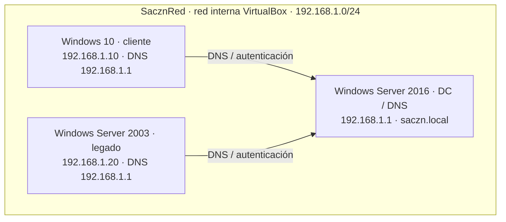
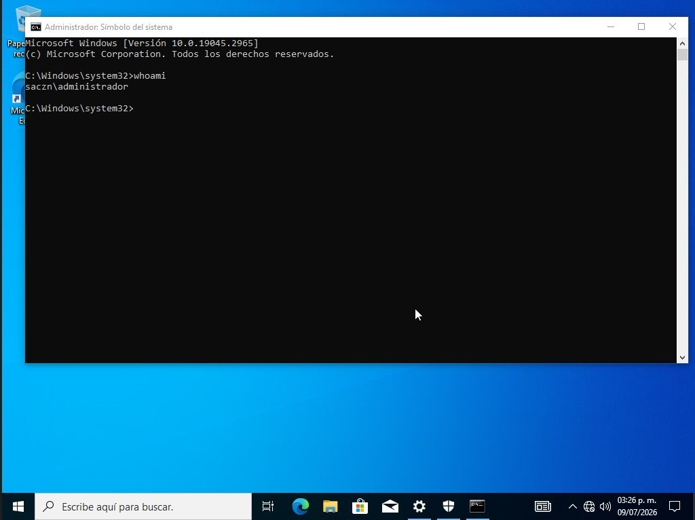
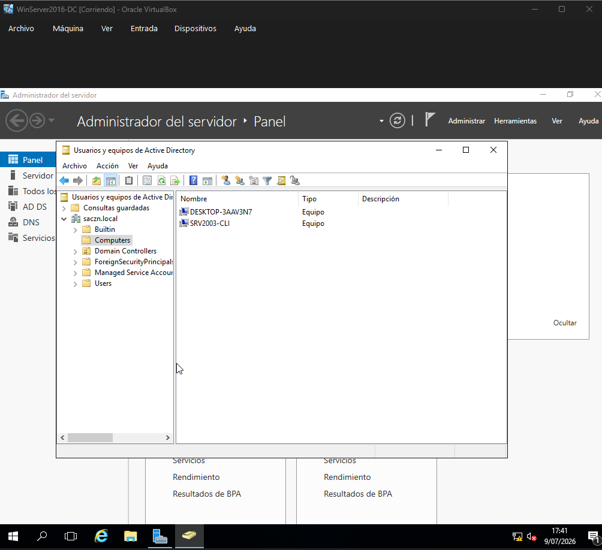

# 14 · Active Directory: identidades e infraestructura

**Estado:** dominio y clientes documentados. GPO, recogida centralizada de eventos y detecciones pendientes.

## Resultado y arquitectura

Despliegue de `saczn.local` en la red interna VirtualBox `SacznRed`. Direccionamiento extraído del informe original (páginas 2, 8, 16 y 20).

La red interna documentada no tiene salida al host ni a Internet. La puerta de enlace indicada en el cliente legado no demuestra que el DC haga enrutamiento. Este laboratorio de compatibilidad no es una arquitectura recomendada de producción.

## Evidencia de validación

- Roles AD DS y DNS instalados y dominio creado.
- Cuenta `scg` creada en el dominio.
- Windows 10: `whoami` devuelve `saczn\administrador` (página 19). No acredita una sesión de la cuenta estándar `scg` en ese equipo.
- Windows Server 2003: `whoami` devuelve `saczn\scg` (página 23).
- Ambos equipos aparecen en el contenedor Computers (página 24).

Que los clientes se hayan unido en esta configuración no demuestra compatibilidad universal ni identifica por sí solo el protocolo de cada autenticación. Los sistemas legados deben mantenerse acotados al ejercicio; añadir un cliente con soporte vigente para las nuevas pruebas defensivas.

## Ampliación SOC / Blue Team

1. [Aplicar y comprobar una GPO en una OU de prueba](GPO-VALIDACION.md).
2. [Recoger y analizar eventos con Wazuh](../16-siem-wazuh/README.md).
3. Continuar con [ataque y defensa](../15-ad-ataque-defensa/README.md) cuando exista telemetría verificable.

## Evidencia del informe original

Página 19: sesión de administrador de dominio en Windows 10.

Página 24: ambos clientes registrados como objetos de equipo en el dominio.

## Informe y trazabilidad

[Leer informe original](informe-practica14.pdf) · [Notas de revisión técnica](../docs/REVISION-TECNICA.md) · [Portafolio](../README.md)

Las imágenes son extracciones de las páginas indicadas en su nombre, sin recrear resultados. El PDF histórico conserva su redacción original; las precisiones de este README deben leerse junto a él.
