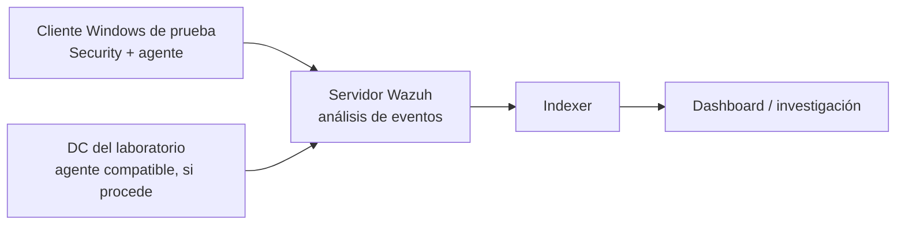

# 16 · Investigación SOC con Wazuh

**Estado:** caso Linux ejecutado e indexado. La ampliación con agente Windows sigue pendiente.

[Informe PDF](informe-practica16.pdf) · [Evidencia de la alerta y del índice](evidencia-sudo.txt) · [Portafolio](../README.md)

## Caso documentado · Uso legítimo de sudo

En una VM de laboratorio importada desde la imagen oficial Wazuh 4.14.11, se habilitaron los servicios del manager y del dashboard y se verificaron los cuatro componentes. La VM se conectó a una red solo anfitrión en VirtualBox.

| Momento (Lima, UTC−5) | Evidencia |
|---|---|
| 26/11/2026, 23:11:50 | Se ejecutó `sudo -n /usr/bin/true`. El journal registró la cuenta de laboratorio, el usuario destino root y el comando. |
| 26/11/2026, 23:11:50.863 | Wazuh creó la alerta **5402**, nivel **3**, desde `journald` para el agente local `000`. |
| Consulta posterior | El indexador devolvió **un documento** con el mismo ID de alerta, regla, comando y marca temporal. |

**Cierre de triaje:** actividad benigna esperada en el ejercicio. La regla detectó correctamente una ejecución con sudo. El comando `true` devuelve éxito y el operador sabía de antemano cuándo se ejecutaría. Ante una alerta equivalente fuera del laboratorio, conviene verificar el usuario, el comando, el equipo y si el cambio estaba autorizado antes de escalarla. La etiqueta ATT&CK de la regla describe una técnica asociada y el contexto determina la relevancia del evento.

**Alcance:** esta prueba usa el agente local del manager. La recogida desde Windows, la comparación con el evento 4625 y la investigación desde el dashboard quedan como ampliación.

## Ampliación pendiente · Autenticación de Windows

### Objetivo

Recoger eventos de un cliente Windows de laboratorio y demostrar el recorrido desde una acción controlada hasta su registro, alerta e investigación. Registrar versiones exactas al ejecutar; consultar requisitos y compatibilidad de la versión de Wazuh elegida antes de instalar.

## Arquitectura propuesta



Es una ampliación propuesta de la [práctica AD](../14-active-directory/README.md), no la topología ya desplegada. Reservar IP y recursos al ejecutar. Mantener el segmento de pruebas aislado; no conectar el cliente Windows Server 2003 a Internet para instalar agentes. Usar un cliente con soporte vigente para la nueva telemetría.

## Fases y entregables

1. **Preparar:** inventario, versiones, snapshots, recursos y sincronización horaria. Instalar los componentes según la documentación oficial para la versión seleccionada.
2. **Aplicar auditoría:** seguir la [validación GPO](../14-active-directory/GPO-VALIDACION.md). Comprobar primero que el evento existe en el endpoint.
3. **Recoger:** revisar si el agente ya recoge Security. Añadir una entrada solo si falta; no duplicarla. Registrar configuración efectiva y estado del agente.
4. **Generar actividad:** un error de contraseña controlado seguido de un acceso legítimo con cuenta de prueba, respetando el umbral de bloqueo. Registrar hora y host.
5. **Localizar:** buscar el evento recibido, documentar sus campos reales y comprobar decodificación. Un evento recogido no necesariamente genera una alerta indexada: depende de reglas, nivel y configuración de almacenamiento.
6. **Detectar:** revisar primero la regla existente. Si se añade una regla local, probarla con `wazuh-logtest` y un evento real sanitizado antes de activarla. Definir claramente umbral, ventana temporal y agrupación por cuenta/host.
7. **Investigar:** completar [la plantilla](INVESTIGACION.md), incluyendo una explicación legítima alternativa y un falso positivo.

Ejemplo de entrada de recogida, para integrar en el bloque `ossec_config` del agente si no existe ya:

```xml
<localfile>
  <location>Security</location>
  <log_format>eventchannel</log_format>
</localfile>
```

No reemplazar el archivo de configuración completo por este fragmento. Validar y reiniciar según la versión instalada. Recoger eventos adicionales puede aumentar volumen y exposición de datos: limitar retención y acceso conforme al laboratorio.

## Interpretación

Un 4625 informa de un inicio de sesión fallido, no confirma fuerza bruta. Credenciales antiguas, servicios mal configurados y errores humanos son explicaciones posibles. Para futuras pruebas de Kerberos, 4769 aparece en el DC y documenta solicitudes de tickets; un evento aislado no confirma Kerberoasting.

## Criterios para completar el laboratorio

- Evento de origen y evento recibido correlacionados por tiempo, equipo e identificador.
- Regla y versión registradas, con alerta observada y explicación de sus condiciones.
- Caso benigno comparativo y limitaciones descritos.
- Capturas sanitizadas, procedimiento de reversión y breve informe de triaje.

## Fuentes

- [Wazuh: imagen oficial para VirtualBox](https://documentation.wazuh.com/current/deployment-options/virtual-machine/virtual-machine.html).
- [Wazuh: recogida de logs por sistema operativo](https://documentation.wazuh.com/current/user-manual/capabilities/log-data-collection/configuration.html).
- [Microsoft: evento 4625](https://learn.microsoft.com/en-us/windows/security/threat-protection/auditing/event-4625).
- [Microsoft: evento 4769](https://learn.microsoft.com/en-us/windows/security/threat-protection/auditing/event-4769).

[Ruta de aprendizaje](../ROADMAP.md) · [Portafolio](../README.md)
