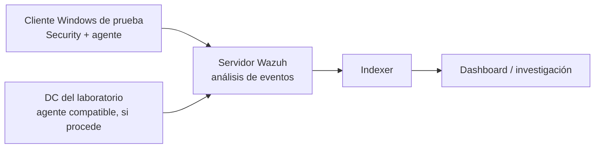

# 16 · Detección y triaje con Wazuh

**Estado: planificada.** Esta guía y la plantilla de investigación están preparadas; no se ha instalado Wazuh ni se han observado alertas como parte de esta ampliación.

## Objetivo

Recoger eventos de un cliente Windows de laboratorio y demostrar el recorrido desde una acción controlada hasta su registro, alerta e investigación. Registrar versiones exactas al ejecutar; consultar requisitos y compatibilidad de la versión de Wazuh elegida antes de instalar.

## Arquitectura propuesta



Es una ampliación propuesta de la [práctica AD](../14-active-directory/README.md), no la topología ya desplegada. Reservar IP y recursos al ejecutar. Mantener el segmento de pruebas aislado; no conectar el cliente Windows Server 2003 a Internet para instalar agentes. Usar un cliente con soporte vigente para la nueva telemetría.

## Fases y entregables

1. **Preparar:** inventario, versiones, snapshots, recursos y sincronización horaria. Instalar los componentes según la documentación oficial para la versión seleccionada.
2. **Aplicar auditoría:** seguir la [validación GPO](../14-active-directory/GPO-VALIDACION.md). Comprobar primero que el evento existe en el endpoint.
3. **Recoger:** revisar si el agente ya recoge Security. Añadir una entrada solo si falta; no duplicarla. Registrar configuración efectiva y estado del agente.
4. **Generar actividad:** un error de contraseña controlado seguido de un acceso legítimo con cuenta de prueba, respetando el umbral de bloqueo. Registrar hora y host.
5. **Localizar:** buscar el evento recibido, documentar sus campos reales y comprobar decodificación. Un evento recogido no necesariamente genera una alerta indexada: depende de reglas, nivel y configuración de almacenamiento.
6. **Detectar:** revisar primero la regla existente. Si se añade una regla local, probarla con `wazuh-logtest` y un evento real sanitizado antes de activarla. Definir claramente umbral, ventana temporal y agrupación por cuenta/host.
7. **Investigar:** completar [la plantilla](INVESTIGACION.md), incluyendo una explicación legítima alternativa y un falso positivo.

Ejemplo de entrada de recogida, para integrar en el bloque `ossec_config` del agente si no existe ya:

```xml
<localfile>
  <location>Security</location>
  <log_format>eventchannel</log_format>
</localfile>
```

No reemplazar el archivo de configuración completo por este fragmento. Validar y reiniciar según la versión instalada. Recoger eventos adicionales puede aumentar volumen y exposición de datos: limitar retención y acceso conforme al laboratorio.

## Interpretación

Un 4625 informa de un inicio de sesión fallido, no confirma fuerza bruta. Credenciales antiguas, servicios mal configurados y errores humanos son explicaciones posibles. Para futuras pruebas de Kerberos, 4769 aparece en el DC y documenta solicitudes de tickets; un evento aislado no confirma Kerberoasting.

## Criterios para completar el laboratorio

- Evento de origen y evento recibido correlacionados por tiempo, equipo e identificador.
- Regla y versión registradas, con alerta observada y explicación de sus condiciones.
- Caso benigno comparativo y limitaciones descritos.
- Capturas sanitizadas, procedimiento de reversión y breve informe de triaje.

## Fuentes

- [Wazuh: recogida de logs por sistema operativo](https://documentation.wazuh.com/current/user-manual/capabilities/log-data-collection/configuration.html).
- [Microsoft: evento 4625](https://learn.microsoft.com/en-us/windows/security/threat-protection/auditing/event-4625).
- [Microsoft: evento 4769](https://learn.microsoft.com/en-us/windows/security/threat-protection/auditing/event-4769).

[Ruta de aprendizaje](../ROADMAP.md) · [Portafolio](../README.md)
